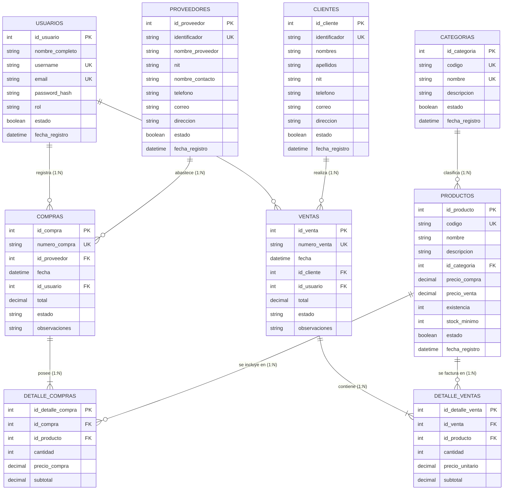

# Modelo Entidad-Relación y Modelo Relacional
## Sistema de Gestión para Supermercado
**Universidad Mariano Gálvez de Guatemala**  
**Facultad de Ingeniería en Sistemas de Información**  
**Cursos:** Bases de Datos I & Desarrollo Web  

---

## 1. Diagrama Entidad-Relación (Mermaid)

---

## 2. Análisis de Relaciones y Cardinalidades

### Relaciones 1 a N (Uno a Muchos):
1. **`CATEGORIAS` -> `PRODUCTOS` (1:N)**:
   - Una categoría clasifica a *muchos* productos (o ninguno).
   - Un producto pertenece estrictamente a *una* categoría.
2. **`PROVEEDORES` -> `COMPRAS` (1:N)**:
   - Un proveedor puede abastecer múltiples órdenes de compra.
   - Cada orden de compra se emite a un único proveedor.
3. **`CLIENTES` -> `VENTAS` (1:N)**:
   - Un cliente puede registrar múltiples compras/ventas en el supermercado.
   - Cada venta está asociada a un único cliente (o Consumidor Final 'C/F').
4. **`USUARIOS` -> `COMPRAS` / `VENTAS` (1:N)**:
   - Un usuario del sistema (cajero o supervisor) registra múltiples compras o ventas.
5. **`COMPRAS` -> `DETALLE_COMPRAS` (1:N)** y **`VENTAS` -> `DETALLE_VENTAS` (1:N)**:
   - Cada comprobante (encabezado) se compone de una o más líneas de detalle.

### Relaciones N a M (Muchos a Muchos):
1. **`COMPRAS` <-> `PRODUCTOS` (N:M)**:
   - Resuelta mediante la entidad débil/intermedia: **`DETALLE_COMPRAS`**.
2. **`VENTAS` <-> `PRODUCTOS` (N:M)**:
   - Resuelta mediante la entidad débil/intermedia: **`DETALLE_VENTAS`**.

---

## 3. Diccionario de Datos y Restricciones (Integridad)

| Tabla | Atributo | Tipo de Dato | Nulo | Restricciones / Claves | Propósito |
| :--- | :--- | :--- | :---: | :--- | :--- |
| **usuarios** | id_usuario | SERIAL / INT | NO | PRIMARY KEY | Identificador numérico único |
| | username | VARCHAR(50) | NO | UNIQUE | Nombre de usuario para login |
| | rol | VARCHAR(30) | NO | CHECK (rol IN ('Administrador', 'Supervisor', 'Cajero', 'Bodeguero')) | Rol de seguridad |
| **categorias**| id_categoria | SERIAL / INT | NO | PRIMARY KEY | Identificador de categoría |
| | codigo | VARCHAR(20) | NO | UNIQUE | Código mnemotécnico (CAT-BEB) |
| **productos** | id_producto | SERIAL / INT | NO | PRIMARY KEY | Identificador de producto |
| | codigo | VARCHAR(50) | NO | UNIQUE | Código de barras / SKU |
| | id_categoria | INT | NO | FOREIGN KEY -> categorias(id_categoria) | Llave foránea |
| | precio_compra| NUMERIC(10,2)| NO | CHECK (precio_compra >= 0) | Costo de adquisición |
| | precio_venta | NUMERIC(10,2)| NO | CHECK (precio_venta >= precio_compra) | Margen de ganancia positivo |
| | existencia | INT | NO | CHECK (existencia >= 0), DEFAULT 0 | Inventario actual disponible |
| | stock_minimo | INT | NO | CHECK (stock_minimo >= 0), DEFAULT 10 | Umbral de reabastecimiento |
| **ventas** | total | NUMERIC(12,2)| NO | CHECK (total >= 0) | Monto total en Quetzales |
| **detalle_ventas**| cantidad | INT | NO | CHECK (cantidad > 0) | Unidades vendidas |
| | subtotal | NUMERIC(12,2)| NO | CHECK (subtotal >= 0) | cantidad * precio_unitario |

---

## 4. Reglas de Negocio en la Base de Datos

1. **Control de Inventario en Ventas**:
   - Para toda venta de un producto con cantidad $Q$, se valida primero:
     $$\text{existencia} \ge Q$$
   - Al registrarse la venta, se actualiza el stock:
     $$\text{existencia}_{\text{nuevo}} = \text{existencia} - Q$$
2. **Control de Inventario en Compras**:
   - Al recibirse una compra con cantidad $Q$, se actualiza el stock:
     $$\text{existencia}_{\text{nuevo}} = \text{existencia} + Q$$
3. **Consistencia de Precios**:
   - Una restricción a nivel de base de datos (`CHECK (precio_venta >= precio_compra)`) garantiza que ningún producto se venda a pérdida.
